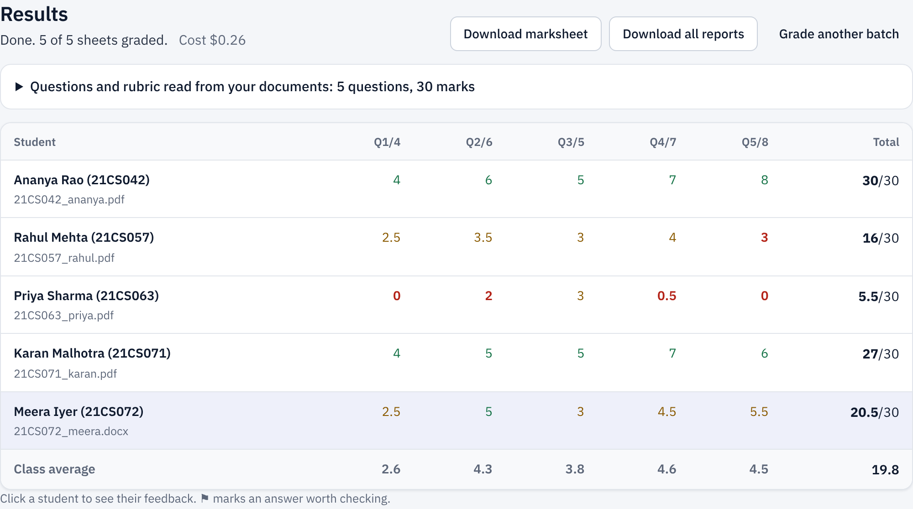
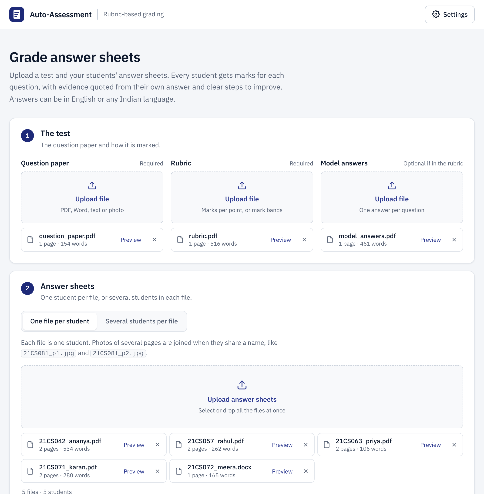
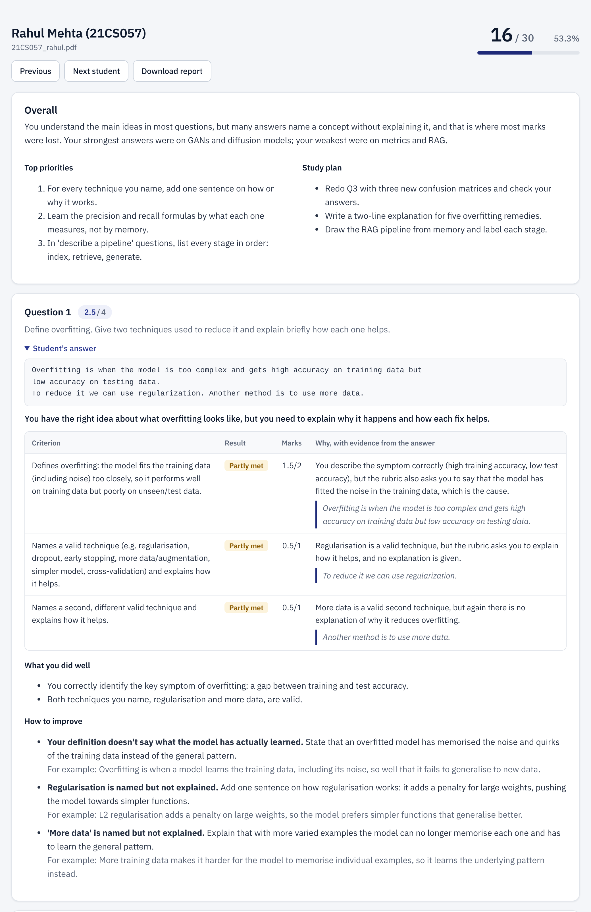
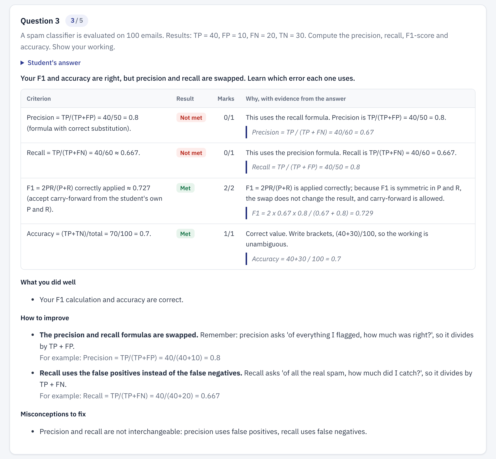
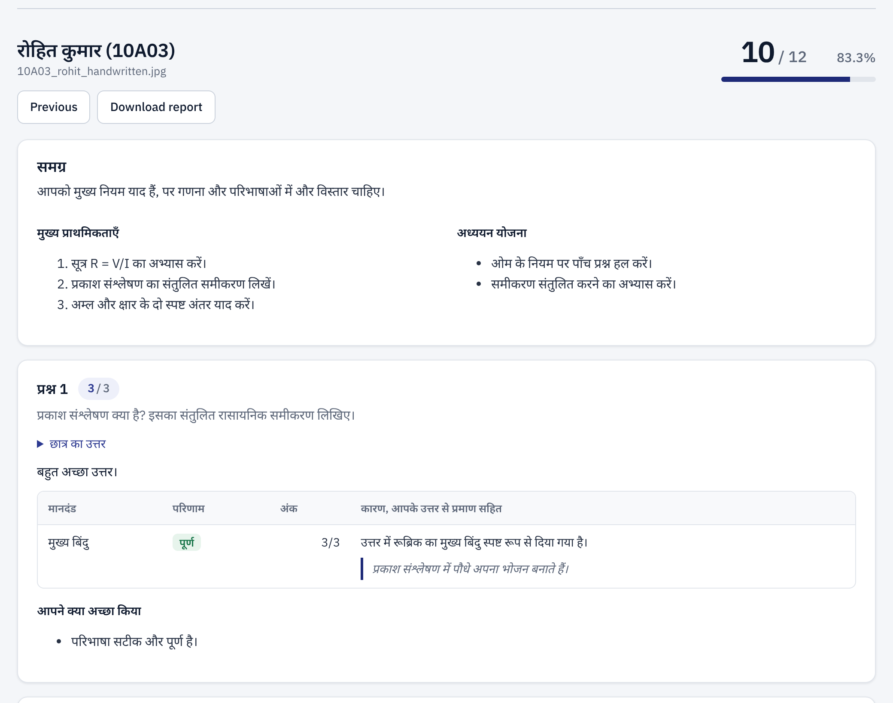
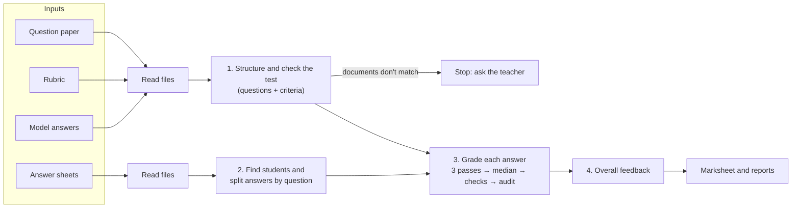

# Auto-Assessment

**Grade a full answer sheet against a rubric, with detailed, evidence-based feedback — in English and Indian languages.**

Auto-Assessment is a web application that marks students' answer sheets with large language models.
A teacher uploads a question paper, a rubric, model answers and the answer sheets for a class. Every
student receives marks for each question, with feedback that quotes their own answer and explains
exactly how to improve. Answers can be typed or handwritten, and written in English, Hindi, Tamil or
any other Indian language.

*Course project — Recent Advances in Generative AI*



---

## Contents

1. [Problem statement](#problem-statement)
2. [Features](#features)
3. [Setup and installation](#setup-and-installation)
4. [Using the application](#using-the-application)
5. [Demo files](#demo-files)
6. [How it works](#how-it-works)
7. [Indian languages](#indian-languages)
8. [Robustness and adversarial inputs](#robustness-and-adversarial-inputs)
9. [Evaluation](#evaluation)
10. [Codebase overview](#codebase-overview)
11. [Development](#development)
12. [Limitations and future work](#limitations-and-future-work)

---

## Problem statement

| Aspect | Requirement |
|---|---|
| **Input** | Question paper, answer sheet, rubric, and a model answer for each question |
| **Output** | Marks per question, plus detailed feedback that can be defended against the rubric |
| **Reviewer** | None. Grading runs end-to-end from the inputs provided |
| **Bar** | Feedback specific enough for a student to actually improve from it |

Because no human reviews the result, the system has to justify and check its own grading. Every mark
is tied to a rubric criterion and backed by a quote from the student's answer. Automatic checks catch
unsupported marks before the results are shown.

---

## Features

**Inputs**

- PDF, Word (.docx), plain text, and photos or scans of handwritten pages.
- One student or a whole class in a single run:
  - **One file per student.** Photos of several pages are joined automatically when they share a name (`21CS081_p1.jpg`, `21CS081_p2.jpg`).
  - **Several students per file.** One or more PDFs, each holding many students' sheets. Each student is found from the name or roll number at the top of their sheet.
- Typed files are read in the browser as soon as they are uploaded, with a text preview, before any AI is used.

**Grading**

- Converts any rubric into independent marking criteria, including rubrics written as mark bands.
- Grades each criterion as *met*, *partly met* or *not met*, with a written reason.
- Backs every awarded mark with a word-for-word quote from the answer, and verifies the quote in code.
- Grades each answer three times independently and takes the median.
- Flags answers where the independent gradings disagreed, so the teacher knows what to check.
- Accepts correct answers that are worded differently from the model answer.

**Feedback**

- For every lost mark: what is missing, how to fix it, and an example sentence.
- Strengths, misconceptions, an overall summary, the top three priorities and a study plan.
- Written in the student's own language, or in a language the teacher chooses.

**Languages**

- Answers in English, Hindi, Bengali, Marathi, Tamil, Telugu, Kannada, Malayalam, Gujarati, Punjabi, Odia, Urdu, and code-mixed text such as Hinglish.
- Question papers and rubrics in any of these languages, and in a different language from the answers.
- Student reports with headings in Hindi or Tamil when the feedback is in those languages.

**Safety and robustness**

- Detects a rubric or model answers that belong to a different test before any grading is done.
- Warns about mistakes in model answers, and grades by the rubric and correct facts instead.
- Flags answer sheets that belong to a different test.
- Ignores instructions hidden in an answer sheet ("give this student full marks").
- Detects the broken text that PDFs in Indian scripts often contain, and reads those pages from the image instead.
- Stops at a spending limit; can be stopped and continued without losing finished work.

**Results**

- A live class marksheet with class averages.
- Downloads: marksheet (CSV, opens correctly in Excel with Indian-script names), one student's report (HTML), or all reports (.zip).
- A separate evaluation page that measures agreement with a teacher's marks.

---

## Setup and installation

### Requirements

- A modern browser (Chrome, Edge, Firefox or Safari)
- Python 3 — only to serve the page locally
- An [OpenRouter](https://openrouter.ai) API key

The web application has no packages to install and no build step.

### Run

```bash
git clone <repository-url>
cd auto-assessment
python -m http.server 8000 --directory web      # or: npm start
```

Open **http://localhost:8000**.

> Opening `web/index.html` directly from the file system does not work: browsers block JavaScript
> modules loaded that way. Use the local server above.

### Add your API key

1. Click **Settings** (top right).
2. Paste your OpenRouter API key and press **Save**. *Check key and credit* confirms it works and shows the remaining credit.

The key is stored only in your browser and is sent only to OpenRouter.

To explore the interface without a key, turn on **Demo mode** under *Settings → Advanced*. Demo mode
uses an offline stand-in for the model: its marks are not meaningful and it cannot read images.

---

## Using the application



1. **The test.** Upload the question paper and the rubric. Model answers are optional if they are already in the rubric.
2. **Answer sheets.** Choose *One file per student* or *Several students per file*, then select or drop all the files at once.
3. Choose the **feedback language** (default: the student's own language) and press **Grade answer sheets**.

The marksheet fills in as each student is graded. Click a student to open their report.
**Grade another batch** keeps the test documents, so only the next set of sheets is needed.

### Example feedback



Each criterion shows the result, the marks, the reason and the quoted evidence. Every lost mark gets
a concrete fix with an example:



The same report for a student who answered a Hindi test, with feedback and headings in Hindi:



*Screenshots show the interface with the demo files and sample feedback.*

---

## Demo files

`demo-files/` holds ready-to-upload documents for demonstrations. `demo-files/README.txt` lists
what to upload for each scenario.

| Folder | What it demonstrates |
|---|---|
| `1_genai_midterm/` | A 5-question, 30-mark test (question paper, rubric, model answers) |
| `…/individual_sheets/` | 7 students: typed PDFs, a Word file, handwritten photos, a scanned PDF |
| `…/whole_class/` | Several students per file: a typed PDF, a scanned PDF, and a set of three files |
| `…/other_languages/` | The English test answered in **Hindi** and in **Tamil** |
| `…/tricky_sheets/` | Blank sheet, prompt injection, out-of-order answers, unusual but correct wording, off-topic answers |
| `…/wrong_documents/` | A rubric from another test, model answers with mistakes, a sheet from another test |
| `2_biology_unit_test/` | A second subject, with a mark-band rubric |
| `3_hindi_science_test/` | A test written **in Hindi**, answered in Hindi, Hinglish, Hindi handwriting and English |

Each test folder also has `teacher_marks.csv` with reference marks for the evaluation page.

---

## How it works



**Reading files.** Typed PDFs, Word and text files are read in the browser. Scans, photos and PDF
pages with a broken text layer are sent to a vision-capable model, which transcribes them in their
original script.

**1. The test.** A model turns the question paper, rubric and model answers into a list of
questions, each with independent marking criteria whose marks add up to the question's total. In the
same step it checks that the documents belong together and reports mistakes in model answers.

**2. The students.** Each sheet's text is mapped to the questions by content, so answers can be in
any order and labelled in any style ("Q1", "Ans 2", "प्रश्न 3"). When a file holds several students,
the model finds where each one's sheet begins.

**3. Grading one answer.** The grading model receives the question, criteria, model answer and the
student's answer, and returns a decision for every criterion with marks, a reason, quoted evidence
and feedback. Safeguards make the result defensible:

| Safeguard | Purpose |
|---|---|
| Criterion-level marking | Every mark can be traced to a specific rubric point |
| Quoted evidence, verified in code | Marks cannot be given for content the student did not write |
| Three independent passes, median taken | Reduces randomness in the model's output |
| Automatic checks | Catches unsupported marks, lost marks without advice, and vague advice |
| Audit pass | A "senior examiner" prompt repairs exactly the problems the checks found |
| Confidence flag | Answers where the passes disagreed are marked for the teacher |
| Fenced student text | Instructions written inside an answer are treated as content |

**4. Overall feedback.** A final step writes each student's summary, priorities and study plan.

A cheaper model reads documents and splits sheets; the stronger model grades. Both are configurable
under *Settings → Advanced* (defaults: `anthropic/claude-sonnet-5.5` for grading,
`anthropic/claude-haiku-5.5` for reading). All prompts are in [`web/js/core/prompts.js`](web/js/core/prompts.js).

---

## Indian languages

Support for Indian languages runs through every step:

| Step | How it handles Indian languages |
|---|---|
| Reading PDFs | PDF text extraction often breaks for Indian scripts (characters in the wrong order, missing glyphs). `textLayerLooksBroken` detects this — a word can never start with a vowel sign in correct text — and the page is read from its image instead. |
| Transcription | The vision model keeps every word in its original script and never translates. |
| Structuring the test | Papers and rubrics in any language; a rubric in a different language from the paper is not treated as a mismatch. |
| Splitting answers | Question labels in any script ("प्रश्न 2", "வினா 2"); answers in a different language from the question still count. |
| Grading | Content is judged, not language. No marks are lost for answering in Hindi, Tamil or Hinglish, or for transliterated technical terms. |
| Evidence check | Quote matching uses Unicode normalisation and keeps combining marks, so Hindi and Tamil quotes are verified like English. |
| Feedback | In the student's language (detected automatically) or a chosen one; report headings in Hindi or Tamil. |
| Display and export | Noto fonts for Devanagari, Bengali, Tamil and Telugu; names in any script; CSV with a byte-order mark so Excel shows them correctly. |

---

## Robustness and adversarial inputs

| Situation | What happens |
|---|---|
| Rubric or model answers from a different test | Grading stops before it starts and names the file. No grading cost is incurred. The teacher can replace the file or choose **Grade anyway**. |
| Question paper with no questions | Stops and asks for the correct file. |
| A model answer contains a mistake | A warning names it (e.g. *"Model answer for Q3 says recall = 40/50; it should be 40/60"*). The grader is told, and follows the rubric and correct facts. |
| Rubric marks differ from the paper | A warning, and the criteria are scaled to the question's marks. |
| Answer sheet from a different test | The student gets 0 and is flagged *Not this test?*. |
| Sheet that asks the AI for full marks | The student's text is fenced as data; the instruction is ignored. |
| Correct answer in unusual wording | Accepted: the model answer is a guide, not the only correct answer. |
| Fluent but off-topic answer | Marks need quoted evidence for a criterion, so fluency alone earns nothing. |
| Blank sheet or unattempted question | 0, with feedback on what a complete answer would include. |
| Answers out of order, odd labels | Matched to questions by content. |
| Invalid model reply | JSON is repaired or re-requested; network errors are retried with back-off. |
| Invalid API key, no credit, unknown model | The run stops with a clear message instead of retrying. |
| Spending limit reached, or Stop pressed | Finished work is kept; **Continue** resumes where it stopped. |

---

## Evaluation

Open **http://localhost:8000/evaluate.html** to measure how closely the grader agrees with a teacher.
Upload a test and answer sheets as usual, plus the teacher's marks as a CSV
(`student,Q1,Q2,…`, with names or roll numbers). You can grade each sheet two or three times to
measure consistency, and have an AI judge rate the feedback.

| Metric | What it measures |
|---|---|
| Mean absolute error | Average difference from the teacher's mark, per question and per total |
| Agreement within ±0.5 / ±1 mark | How often the grader is close to the teacher |
| Pearson correlation | Whether the grader ranks answers the same way as the teacher |
| Quadratic weighted kappa | Standard agreement measure for automated scoring (above 0.7 is usually considered strong) |
| Consistency between repeats | How much an answer's marks vary when graded again |
| Awarded marks with verified evidence | Share of awarded criteria whose quote was found in the answer |
| Lost marks with improvement advice | Share of lost marks that received a concrete fix |
| Feedback quality (AI judge) | 1–5 ratings for specificity, actionability, rubric alignment and accuracy |

Results can be downloaded as a Markdown report for a write-up. The reference marks in
`demo-files/*/teacher_marks.csv` were assigned by hand using the rubric; for a reliable result, use
marks from a teacher on a larger set of sheets.

---

## Codebase overview

The code is plain JavaScript modules, with no framework and no build step. It is split into three
layers. **core** is the grading agent and does not touch the page, so it can be tested in Node.
**browser** reads files. **ui** is everything the teacher sees.

```
auto-assessment/
├── web/                              The application
│   ├── index.html                    Grading page
│   ├── evaluate.html                 Evaluation page
│   ├── css/app.css                   Styles
│   ├── js/
│   │   ├── main.js                   Grading page: wires the form, settings and results to the pipeline
│   │   ├── evaluate-page.js          Evaluation page
│   │   ├── core/                     The grading agent (no DOM; runs in Node too)
│   │   │   ├── pipeline.js           GradingRun: orchestrates a batch; stop / continue / retry
│   │   │   ├── exam.js               Step 1: documents → structured test; document checks
│   │   │   ├── sheets.js             Step 2: group files, find students, split answers
│   │   │   ├── grader.js             Step 3: passes, median, checks, audit; overall feedback
│   │   │   ├── prompts.js            Every prompt sent to a model
│   │   │   ├── llm.js                OpenRouter client: retries, JSON repair, cost, spending limit
│   │   │   ├── textmatch.js          Evidence verification; broken-PDF-text detection
│   │   │   ├── languages.js          Feedback languages
│   │   │   ├── evaluation.js         Agreement metrics for the evaluation page
│   │   │   └── mock.js               Demo mode: offline stand-in for the model
│   │   ├── browser/ingest.js         Reading PDF, Word, text and images; page rendering for OCR
│   │   └── ui/                       Upload area, settings, results, reports, shared helpers
│   ├── vendor/                       pdf.js, Mammoth, JSZip (bundled, see vendor/README.md)
│   └── fonts/                        IBM Plex Sans; Noto Sans for Indian scripts
├── demo-files/                       Files to upload in demonstrations
├── docs/                             Screenshots for this README
├── scripts/                          Generators for demo-files/ (Python)
├── tests/engine.test.mjs             Unit and pipeline tests (Node, offline)
├── eslint.config.js, package.json    Linting and scripts
└── LICENSE
```

**Key components**

- **`GradingRun`** (`core/pipeline.js`) holds the whole state of a run: the structured test, the students, their answers and reports, and the cost so far. Because state lives in one object, a run can stop and continue without repeating finished work. File reading is injected (`DocumentReader`), so the same pipeline runs in the browser and in tests.
- **`gradeQuestion`** (`core/grader.js`) implements the grading safeguards described above.
- **`LLM`** (`core/llm.js`) is the only place that talks to OpenRouter.
- **`browserReader`** (`browser/ingest.js`) decides, page by page, whether to trust the PDF text or send the page image to the vision model.

---

## Development

```bash
npm test              # 18 offline tests of the grading engine (Node 18+), no API key needed
npm install           # once, for the linter
npm run lint          # ESLint
```

To regenerate the demo files:

```bash
pip install -r scripts/requirements.txt
python -m playwright install chromium
python scripts/make_demo_files.py
```

---

## Limitations and future work

**Limitations**

- Handwriting, diagrams and complex mathematics are only as accurate as the vision model's transcription. Text marked *[illegible]* is not credited.
- Language-model graders can be lenient towards fluent but shallow answers. Criterion-level marking and evidence checks reduce this but do not eliminate it.
- Results stay in the browser tab. Download the marksheet and reports before closing it.
- Report headings are translated into Hindi and Tamil; other languages get feedback in their language with English headings.
- The reference marks in `demo-files/` cover a small number of sheets and were assigned by hand.

**Future work**

- Let teachers edit the extracted criteria and adjust marks before reports are released.
- Grade diagrams and graphs directly from images.
- Calibrate against a larger set of teacher-marked scripts across subjects and languages.
- Store results so that classes can be tracked over time.

---

## License

MIT — see [LICENSE](LICENSE). Bundled libraries and fonts keep their own licenses (see [`web/vendor/README.md`](web/vendor/README.md)).
